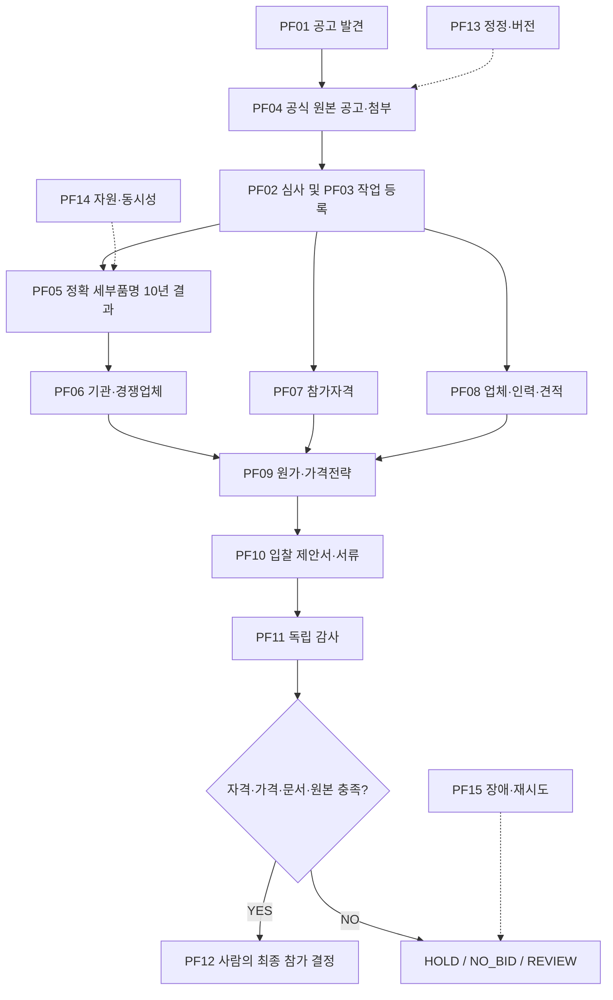

# 조달청 자동화 프로젝트 — 최종 기획 기준서 (마스터)
> **기준일:** 2026-10-28 · **문서 상태:** 최종 업무 요구사항 기준서(설계·검증의 기준, 구현 완료 선언 아님) · **저장 위치:** `lyonbegin/procureflow/docs/FINAL_PROJECT_MASTER_PLAN_2026-10-28.md`

## 0. 이 문서의 용도
- 본 문서는 조달청 자동화 프로젝트에서 여러 채팅에 걸쳐 합의한 **최종 목표와 수용 기준을 하나의 문서로 고정한 정본(SSOT)**이다.
- 프로젝트의 새 채팅은 이 문서를 먼저 읽고 기존 GitHub 코드·현재 배포 상태와 대조한다. 코드가 존재하거나 n8n이 설치되었다는 이유만으로 업무가 완성되었다고 보고하지 않는다.
- GitHub에서 공통으로 열람할 수 있도록 보관한다. **ChatGPT 프로젝트의 모든 채팅에 자동 첨부되는 파일은 아니므로**, 공통 프로젝트 자료로도 등록해야 한다.
- 실제 조달청 로그인·전자서명·입찰참가 버튼 클릭·투찰 제출은 승인 없이 자동 실행하지 않는다.

## 1. 최종 목적·끝점
새 나라장터(G2B) 발주가 발견되면 중복·기처리 여부를 확인하고 **사용자가 발주 한 건을 선택**한다. 해당 건에서 공고·첨부 원본을 확보하고, **선택 발주의 정확한 세부품명**과 **발주기관**을 기준으로 과거 10년의 실제 개찰·투찰 및 확정 낙찰 기록을 조사한다. 이어서 예상 경쟁업체, 입찰 참가자격, 공급·수행 인력, 견적, 원가, 가격 전략, 제안서·참가서류를 생성·검증한다. **모든 근거를 정리한 후 사람이 최종 입찰참가 여부를 결정하는 직전 단계**가 업무 종료점이다.

완성 시 화면에는 `READY_FOR_MANUAL_PARTICIPATION` / `HOLD` / `NO_BID` / `REVIEW` 및 원인을 표시한다. 자동 투찰·전자서명·제출은 별도 승인 없이 구현·실행하지 않는다.

### 핵심 수량
| 구분 | 최종 요구 |
|---|---:|
| 조달청 실제 업무 기능 | **104개**, 7개 카테고리 |
| 세부 업무 블록 | **43개**, 입력·출력·선행조건·증빙 |
| 운영 n8n 워크플로 | **PF01~PF15 (15개)** + 통합 PF00 |
| 가상/장애 검증 | **S01~S10 (10개)** |
| 별도 노드 편집·테스트·디버깅 검토 목록 | **80개(기존 81~160)**. 104 업무 기능과 **다른 목록** |

## 2. 발주 한 건 기준 업무 흐름
1. G2B 최신 공고 상시 검색·갱신, 재공고/정정/취소 감지, 선택 건의 동일 건 식별.
2. 해당 건 작업 소유권·버전·우선순위 등록. **다른 발주 기록과 결과를 혼합하지 않는다.**
3. 공식 공고 상세와 원본 첨부 파일 전량 다운로드·무결성 확인·문서/표/수량/조건 구조화.
4. 8자리 일반 분류와 실제 공고 원본의 **정확한 10자리 세부품명**을 구분하여 공식 확인.
5. 해당 세부품명과 발주기관을 기준으로 10년 범위의 구형·신형 공고를 분할 조사하고, **공고 제목이 아닌 실제 개찰·참가업체·투찰금액·투찰률·순위·확정 낙찰업체·금액**을 수집·연결한다.
6. 과거 반복 참가업체·동일 기관 수주 및 투찰률을 분석하여 이번 공고 경쟁업체 가능성을 근거로 추정한다.
7. 참가자격/지역/중소기업/공동수급/보증금/면허/기술·인력 및 증빙서류를 판정한다.
8. 필요 공급업체·물품·외주·수행 인력의 수급 가능성과 견적을 조사한다. 공공 통계 및 사람인·잡코리아·고용24 등 관련 인력 채용자료를 참고한다.
9. 원가(견적·재료·인건비·경비·관리비·이윤·세금), 가격 하한과 과거 낙찰 통계를 반영하여 가격 시나리오 작성.
10. 제안서·참가서류·실제 제출양식을 준비하고 원본 증빙, 감사, 누락·상충 조건을 독립 검증한다.
11. 검증 후 **사람이 최종 입찰참가를 결정**한다. 미충족은 HOLD, 자격 불충족은 NO_BID, 상충·감사 이슈는 REVIEW.

### 업무 간 필수 실행 관계

*위 도식은 업무 의존관계의 기준이다. PF13~PF15는 한 번만 거치는 직렬 단계가 아니라 사건 발생 시 전체 흐름을 통제하는 수평 기능이다.*

## 3. 104개 업무 기능 분류
| 번호 | 범위 | 분야 | 완료 판정의 핵심 |
|---|---|---|---|
| 1~16 | 16 | 공고 수집·변경 | 공식 신규 공고와 변경 원본·중복 방지 |
| 17~32 | 16 | 공고 상세·첨부 | 원본 파일·무결성·요건 추출·대조 |
| 33~48 | 16 | 과거 실제 개찰·낙찰 | 참가·투찰·개찰·확정 낙찰 원본 |
| 49~60 | 12 | 정확한 세부품명·기관 | 10년 공식 전수·기관·경쟁업체 분석 |
| 61~76 | 16 | 자격·공급·인력 | 공식 참가요건·보유 증빙·유효 견적 |
| 77~94 | 18 | 원가·가격·서류 | 비용·가격근거·제안서·최종 패키지 |
| 95~104 | 10 | 운영·통제 | 로그·단계·재시도·최종 증빙 |
| **합계** | **104** | | **104개 기능 각각에 별도 입력·실행·결과·증빙·검증 필수** |

## 4. 가장 중요하게 확정된 10년 수집 정의
- **테스트 선택 발주:** `R26BK01787028` / 차수 `000`
- **8자리 공고 분류:** 정보시스템개발서비스 `81111599`
- **현 코드의 10자리 세부종목 후보:** `8111159901` — **실제 선택 공고 원본과의 공식 일치 증빙은 별도로 검증해야 한다.**
- 당시 구현 테스트용 조회 기간: **2016-10-24 ~ 2026-10-24**. 운영은 선택 발주와 조회 시점에 맞는 10년 범위로 계산한다.
- 공고 후보 몇 건 또는 같은 8자리 분류의 단순 제목 수집은 전수검색 완료가 아니다.
- 구형·신형 공고체계, 공고번호·차수·재입찰 회차를 구분하고 각 기간창의 공식 조회 완료·개찰·확정 낙찰·참가업체 자료를 확인한다.
- 10년 전수 완료 판정은 **누락·실패·빈 응답·부분 수집을 별도 기록하고 검증된 원본 개찰·확정 낙찰 증거가 모두 확보된 경우**에만 한다. 원본 식별자를 추적한다.
- 경쟁업체 예측은 확인된 투찰 이력, 동일 기관 발주, 정확 세부품명 기록을 통계적 근거로 연결하며 추정과 관측을 구분한다.

## 5. 운영 워크플로 PF01~PF15
| ID | 역할 | 종료/후속 |
|---|---|---|
| PF01 | 공고 상시 수집 | PF02, PF13 |
| PF02 | 발주 등록·1차 심사 | PF03 |
| PF03 | 분석 작업 할당 | PF04, PF07, PF08 |
| PF04 | 공식 공고·첨부 처리 | PF05, PF07, PF08, PF10 |
| PF05 | 10년 개찰·낙찰 전수 | PF06, PF11 |
| PF06 | 발주기관·경쟁업체 분석 | PF09, PF10, PF12 |
| PF07 | 입찰참가자격 검증 | PF09, PF10, PF12 |
| PF08 | 공급업체·인력 조사 | PF09, PF10 |
| PF09 | 원가·가격전략 | PF10, PF12 |
| PF10 | 제안서·서류 | PF11, PF12 |
| PF11 | 독립 원본·결과 감사 | PF12, PF13 |
| PF12 | 입찰 참여 의사결정 | 사람 최종 판단 |
| PF13 | 정정·분석버전 갱신 | PF04, PF05, PF06, PF07, PF08, PF09, PF10 |
| PF14 | 전역 API·Worker 자원 통제 | PF03, PF05 |
| PF15 | 장애 복구·상태 대조 | PF03, PF05, PF11 |
PF00은 선택 발주 전체 실행을 통제한다. **실제 n8n 기본 노드와 원본 UI에서** 순차·병렬·IF·Merge·Wait·재시도·이벤트·하위 워크플로·승인 대기를 구성한다. PF13 정정, PF14 자원, PF15 장애는 전체 플로우와 교차 연결한다.

## 6. n8n 단일 실행 엔진과 사용자 경험
**확정 결정:** 기존 자체 React Flow·DAG 실행 엔진은 폐기한다. n8n 공식 원본 소스와 **실제 네이티브 편집기**에서 모든 플로우를 생성·연결·저장·실행·관찰한다. 정적 Vue Flow 조회 화면은 완성품으로 인정하지 않는다.

### 필수 기능
- 편집: 노드 검색·추가·생성·복제·삭제·이동·연결/연결 해제·입력/출력/조건/자격증명 설정.
- 제어: 전체 실행, 선택 노드 실행, 이전·다음 노드/지정 노드까지 실행, 중지·일시정지·재개·재시도·부분 재실행.
- 데이터: 현재 노드의 실제 입력/출력 JSON·문서·파일·HTTP 상태·증빙 링크; 테스트 수동 입력/Mock 분리.
- 관찰: 병렬 분기·합류·대기·실패·재시도·Worker Job ID·실행 시간·진행률·차수/버전·실시간 단계 강조.
- 디버깅: 중단점, 핀 출력, 변수/스키마/Assertion, 실행 재현, 오류 본문·전후 데이터 비교, 스텝 테스트.
- 관리: 실제 서버 저장·재열기, 버전/감사 로그, 건별 독립 실행, 큐·리소스·중복 방지, 보안/RBAC.
- **연속 경험:** 화면에서 **노드 편집 → 서버 저장 → 실제 엔진 실행 → 노드별 상태 확인 → 다음 단계 실행**이 끊어지지 않아야 한다. 브라우저 localStorage에만 저장하고 실행 엔진은 옛 JSON을 실행하면 미완료다.

### 보안·운영
- 자격증명은 n8n 암호화 저장소 등 통제된 비밀 저장소에 보관하고 GitHub·문서·노드 JSON에 평문 금지.
- 세부 결과의 출처와 원본 URL·수집 시간·해시·검증 결과를 보존한다.
- 실패한 외부 호출은 승인되지 않은 재시도로 중복 등록하지 않는다. 자원 제한·멱등성·락과 타임아웃을 검증한다.
- 가상 테스트와 공식 운영 증빙을 엄격히 분리한다. '테스트 성공'은 '10년 실제 전수 수집 성공'을 의미하지 않는다.

## 7. S01~S10 실제 사용자 시나리오 검증
| ID | 시험 상황 | 기대 최종 상태 | n8n에서 검사할 행동 |
|---|---|---|---|
| S01 | 정상 발주 — 근거와 승인 모두 확보 | `READY_FOR_MANUAL_PARTICIPATION` | 13개 테스트 단계가 실제 노드 실행/분기·차단 증거를 남겨야 함 |
| S02 | 대상 외 공고 — 불필요한 분석 차단 | `NO_BID` | 3개 테스트 단계가 실제 노드 실행/분기·차단 증거를 남겨야 함 |
| S03 | 공식 10자리 미확인 — 이력 수집 차단 | `HOLD` | 9개 테스트 단계가 실제 노드 실행/분기·차단 증거를 남겨야 함 |
| S04 | 정정공고 v2 — 구버전 결과 격리 | `HOLD` | 16개 테스트 단계가 실제 노드 실행/분기·차단 증거를 남겨야 함 |
| S05 | 429·503 장애 — 121개 중 114개 완료 | `HOLD` | 10개 테스트 단계가 실제 노드 실행/분기·차단 증거를 남겨야 함 |
| S06 | 필수 자격 미충족 — 입찰 불가 | `NO_BID` | 7개 테스트 단계가 실제 노드 실행/분기·차단 증거를 남겨야 함 |
| S07 | 견적 4개 요청·유효 1개 — QUORUM 미달 | `HOLD` | 10개 테스트 단계가 실제 노드 실행/분기·차단 증거를 남겨야 함 |
| S08 | Worker 장애 — 격리·대조 후 재배정 | `REVIEW` | 16개 테스트 단계가 실제 노드 실행/분기·차단 증거를 남겨야 함 |
| S09 | 독립 감사 중대오류 — 기존 승인 철회 | `HOLD` | 15개 테스트 단계가 실제 노드 실행/분기·차단 증거를 남겨야 함 |
| S10 | 발주 세 건 경합 — API 호출 할당량 1개 | `HOLD` | 8개 테스트 단계가 실제 노드 실행/분기·차단 증거를 남겨야 함 |
**최종 검증:** 사용자가 S01~S10 하나를 눌러 실행할 때 n8n 실행 ID·실제 노드별 상태·입력/출력·실패 위치를 실시간으로 볼 수 있어야 한다. 가상의 이벤트를 직렬로 재생한 결과만으로 실제 장애복구·동시성 검증 완료라고 주장하지 않는다.

## 8. 별도 80개 노드 테스트·디버깅 요구
기존 보고서 `reports/workflow_81_160_implementation_20261025.md`의 80개는 104개 업무 기능과 **완전히 별개**이다. 대표 범위는:
- 노드 테스트용 텍스트·숫자·날짜·JSON·파일 업로드, 입력출처 선택/수정, HTTP 메서드·인증·헤더, 응답 점검;
- 현재 노드/선택 노드/다음 노드/하위 워크플로 단위 실행, 중단점·Pause/Resume/Stop/Skip/Retry;
- Pin output·입출력 비교·로그·변수 감시·실패 주입·스키마 검증·Mock·Replay·체크포인트;
- 브라우저 편집·실행 UX의 실제 사용자 E2E, 동시성·자원 경합·복구, 저장 지속성.
기존 2026-10-25 보고서의 `구현 19 / 부분 47 / 미구현 14`는 **당시 테스트 범위 분류**이며 실서비스 전체 완료율이 아니다. 본 정본의 최종 수용 기준은 80개 각각의 **실제 n8n 엔진 및 브라우저 검증**이다.

## 9. 필수 최종 산출물
| 산출물 | 검증해야 할 내용 |
|---|---|
| 발주 분석서 | 공식 공고, 계약 조건, 마감, 기관, 원본 첨부 |
| 10년 결과 분석서 | 같은 세부종목의 실제 참가업체·금액·투찰률·개찰순위·확정 낙찰결과 |
| 경쟁업체 분석 | 발주기관·세부종목 반복 참가 근거와 이번 참가 가능성 |
| 자격 보고 | 등록·면허·지역·인증·공동수급·보증금 및 부적격 판정 |
| 수행/공급/인력 계획 | 인력·납기·공급업체·견적·기술 가능성 |
| 원가·투찰전략 | 실제 원가·가격대·수익성·과거 통계·제안 투찰가 |
| 최종 서류 패키지 | 제출양식·제안서·필수 첨부 및 누락·상충 감사 |
| n8n 실행 이력 | 실제 실행 ID와 전 노드 입력/출력/상태/시간·증빙 |
| 최종 심사 상태 | READY / HOLD / NO_BID / REVIEW와 사유 |
| 사람의 결정 화면 | 원본 근거 확인 후 최종 입찰참가 여부 결정 |

## 10. 업무 완료 판정 및 개발 보고 원칙
- '문서 작성', '104개 이름 등록', 'JSON 가져오기', 'n8n 화면 기동', '가상 테스트 성공'은 **완료 판정 아님**.
- **각 104개 기능**에 대해 실데이터 입출력, 공식 원본, 누락 처리, 증빙 기준 충족 여부를 개별 판정한다.
- n8n 편집기에서는 노드 추가·삭제·이동·연결·설정·저장·재열기, 단계별·전체 실행, 실행 중 모니터링을 **사람이 실제 브라우저에서** 확인한다.
- PF13 정정 감지 시 과거 버전 영향 작업만 무효화·재실행, PF14 글로벌 자원 제한, PF15 실제 중단·재시도·복구를 검증한다.
- 발주별 개별 분석→자료 수집→근거 검증→서류 생성→사람 최종 판단이 실제로 이어져야 한다.
- **기능 상태는 미구현/부분 구현/코드 검사 통과/시험 인스턴스 E2E 통과/운영 공식 데이터 증빙 통과로 분리 보고한다.**
- 같은 n8n 단일 엔진을 사용하며, 이전 자체 React Flow/DAG 실행 코드를 되살리거나 병행 운영하지 않는다.

## 부록 A. 104개 기능 원문 목록
| 번호 | 업무 기능 | 분야 |
|---:|---|---|
| 1 | 실제 G2B 신규 입찰공고 자동 검색 | 신규 공고·변경 감시 |
| 2 | 신규 공고 정기 자동 업데이트 | 신규 공고·변경 감시 |
| 3 | 신규 공고번호 추출 | 신규 공고·변경 감시 |
| 4 | 공고차수 구분 | 신규 공고·변경 감시 |
| 5 | 공고게시일 확보 | 신규 공고·변경 감시 |
| 6 | 투찰마감일 확보 | 신규 공고·변경 감시 |
| 7 | 공고명 확보 | 신규 공고·변경 감시 |
| 8 | 공고기관·수요기관 확보 | 신규 공고·변경 감시 |
| 9 | 물품·용역 업무 구분 | 신규 공고·변경 감시 |
| 10 | 공식 세부 품목분류 확보 | 신규 공고·변경 감시 |
| 11 | 발주요청과 정식 공고 구분 | 신규 공고·변경 감시 |
| 12 | 취소·정정·재공고 식별 | 신규 공고·변경 감시 |
| 13 | 공고조건 변경 감지 | 신규 공고·변경 감시 |
| 14 | 공고 변경 이력 보존 | 신규 공고·변경 감시 |
| 15 | 공고 중복 저장 방지 | 신규 공고·변경 감시 |
| 16 | 신규 공고 작업 큐 등록 | 신규 공고·변경 감시 |
| 17 | 공고 원본 상세조회 | 공식 상세·첨부 |
| 18 | 공고 상세 JSON 증빙 저장 | 공식 상세·첨부 |
| 19 | 세부품명·분류번호 추출 | 공식 상세·첨부 |
| 20 | 기관 코드 추출 | 공식 상세·첨부 |
| 21 | 계약방법 추출 | 공식 상세·첨부 |
| 22 | 낙찰자 결정방법 추출 | 공식 상세·첨부 |
| 23 | 기초금액·추정가격·예산 구분 | 공식 상세·첨부 |
| 24 | 지역제한 추출 | 공식 상세·첨부 |
| 25 | 업종·면허·등록자격 추출 | 공식 상세·첨부 |
| 26 | 중소기업 등 제한 추출 | 공식 상세·첨부 |
| 27 | 납품·수행기간 및 장소 | 공식 상세·첨부 |
| 28 | 첨부문서 목록 전체 확보 | 공식 상세·첨부 |
| 29 | 첨부파일 원본 다운로드 | 공식 상세·첨부 |
| 30 | 첨부 파일 무결성 및 버전 | 공식 상세·첨부 |
| 31 | 첨부문서 텍스트·표 구조 추출 | 공식 상세·첨부 |
| 32 | 공고 본문과 첨부 증빙 대조 | 공식 상세·첨부 |
| 33 | 과거 개찰 목록 수집 | 과거 개찰·낙찰 |
| 34 | 참가업체 기록 수집 | 과거 개찰·낙찰 |
| 35 | 업체별 투찰금액 저장 | 과거 개찰·낙찰 |
| 36 | 업체별 투찰률 저장 | 과거 개찰·낙찰 |
| 37 | 업체별 개찰순위 | 과거 개찰·낙찰 |
| 38 | 확정 낙찰업체 확인 | 과거 개찰·낙찰 |
| 39 | 최종 낙찰금액 | 과거 개찰·낙찰 |
| 40 | 사업자번호 업체 식별 | 과거 개찰·낙찰 |
| 41 | 과거 개찰 중복 제거 | 과거 개찰·낙찰 |
| 42 | 공고차수·재입찰 집행 구분 | 과거 개찰·낙찰 |
| 43 | 과거 원본 JSON 저장 | 과거 개찰·낙찰 |
| 44 | 최근 개찰 주기 갱신 | 과거 개찰·낙찰 |
| 45 | 과거 개찰 백필 | 과거 개찰·낙찰 |
| 46 | 과거 10년 개찰·낙찰 전수 | 과거 개찰·낙찰 |
| 47 | 공고번호별 과거 개찰조회 | 과거 개찰·낙찰 |
| 48 | 신규 공고와 과거 결과 연결 | 과거 개찰·낙찰 |
| 49 | 선택 공고 10자리 세부품명번호 원본 확인 | 정확한 세부품명·발주기관 분석 |
| 50 | 해당 세부품명 10년 개찰결과 전체 확보 | 정확한 세부품명·발주기관 분석 |
| 51 | 해당 세부품명 10년 확정 낙찰결과 전체 확보 | 정확한 세부품명·발주기관 분석 |
| 52 | 구형·신형 과거 개찰 공고번호 통합 | 정확한 세부품명·발주기관 분석 |
| 53 | 선택 세부품명 10년 개찰기간 구간 관리 | 정확한 세부품명·발주기관 분석 |
| 54 | 모든 구간의 실제 개찰·낙찰 결과 순회 | 정확한 세부품명·발주기관 분석 |
| 55 | 과거 참가업체·투찰금액·순위 저장 | 정확한 세부품명·발주기관 분석 |
| 56 | 과거 확정 낙찰업체·낙찰금액 대조 | 정확한 세부품명·발주기관 분석 |
| 57 | 동일 발주기관의 실제 개찰·낙찰 분석 | 정확한 세부품명·발주기관 분석 |
| 58 | 발주기관 코드별 확정 결과 집계 | 정확한 세부품명·발주기관 분석 |
| 59 | 정확 일치 세부종목의 반복 참가업체 분석 | 정확한 세부품명·발주기관 분석 |
| 60 | 10년 투찰·낙찰 실적 근거 보고서 저장 | 정확한 세부품명·발주기관 분석 |
| 61 | 필수 입찰참가 자격 추출 | 자격·공급업체·인력 |
| 62 | 자사 업종등록 대조 | 자격·공급업체·인력 |
| 63 | 지역제한 적격성 검증 | 자격·공급업체·인력 |
| 64 | 중소기업 요건 검증 | 자격·공급업체·인력 |
| 65 | 필수 인증·면허 검증 | 자격·공급업체·인력 |
| 66 | 가능·불가 판정 근거 | 자격·공급업체·인력 |
| 67 | 공동수급·분담이행 조건 | 자격·공급업체·인력 |
| 68 | 입찰보증금 조건 | 자격·공급업체·인력 |
| 69 | 필수 참가서류 목록 | 자격·공급업체·인력 |
| 70 | 보유 증빙과 요구 증빙 대조 | 자격·공급업체·인력 |
| 71 | 공급업체 DB 관리 | 자격·공급업체·인력 |
| 72 | 품목별 공급 가능 업체 | 자격·공급업체·인력 |
| 73 | 공급·수행 가능성 검증 | 자격·공급업체·인력 |
| 74 | 견적요청 생성 | 자격·공급업체·인력 |
| 75 | 견적회신 원본 수집 | 자격·공급업체·인력 |
| 76 | 업체별 원가·납기 비교 | 자격·공급업체·인력 |
| 77 | 기초금액 정확 확인 | 가격·제안서·서류 |
| 78 | 추정가격·예산 정규화 | 가격·제안서·서류 |
| 79 | 규격·수량 내역서 분석 | 가격·제안서·서류 |
| 80 | 공급업체 견적원가 | 가격·제안서·서류 |
| 81 | 실제 인건비·노무비 | 가격·제안서·서류 |
| 82 | 실제 재료비·경비·외주비 | 가격·제안서·서류 |
| 83 | 일반관리비·이윤 | 가격·제안서·서류 |
| 84 | 세액 산출 | 가격·제안서·서류 |
| 85 | 총 원가 계산 | 가격·제안서·서류 |
| 86 | 동일 분류 낙찰가격 비교 | 가격·제안서·서류 |
| 87 | 투찰률 분포 추정 | 가격·제안서·서류 |
| 88 | 공고의 낙찰하한율 적용 | 가격·제안서·서류 |
| 89 | 가격 시나리오 비교 | 가격·제안서·서류 |
| 90 | 목표이익·수익성 검증 | 가격·제안서·서류 |
| 91 | 최종 투찰금액 제안 | 가격·제안서·서류 |
| 92 | 제안서·참가서류 생성 | 가격·제안서·서류 |
| 93 | 제출양식 반영 | 가격·제안서·서류 |
| 94 | 최종 입찰 패키지 검증 | 가격·제안서·서류 |
| 95 | 입찰 건별 작업관리 | 운영·통제·검증 |
| 96 | 단계별 진행 상태 추적 | 운영·통제·검증 |
| 97 | 작업큐·Worker 실행 | 운영·통제·검증 |
| 98 | 수집 로그와 오류 증빙 | 운영·통제·검증 |
| 99 | 선택 건 독립 작업 소유 | 운영·통제·검증 |
| 100 | 원본·분석결과 통합 | 운영·통제·검증 |
| 101 | 일시정지·재개 | 운영·통제·검증 |
| 102 | 실패 재시도·수동 승인 | 운영·통제·검증 |
| 103 | 입찰참가 직전 상태 검증 | 운영·통제·검증 |
| 104 | 최종 제안서·가격·서류·근거 검증 | 운영·통제·검증 |

## 부록 B. 43개 업무 블록 및 입출력 계약
| 블록 | 명칭 | 기능번호 | 필수 입력 | 출력 | 후속 |
|---|---|---|---|---|---|
| N01 | 신규공고 발견 | 1,2 | query.window | tender_candidates[] | N02 |
| N02 | 공고번호·차수 식별 | 3,4,11,15 | tender_candidates[] | tender_identifiers[] | N03, N05, O01 |
| N03 | 공고 속성 정규화 | 5,6,7,8,9,10 | N05.official_notice | tender_context | N06, N07 |
| N04 | 정정·취소·버전 비교 | 12,13,14 | official_notice+previous_revision | change_set | PF13.revalidate, O04 |
| N05 | 공식 공고 상세 | 17,18 | tender_identifiers[] | official_notice | N03, N08, N10 |
| N06 | 공식 세부코드·기관 | 19,20 | official_notice | verified_detail10+agency_code | H01, H09, Q01 |
| N07 | 계약조건·마감·금액 | 21,22,23,24,25,26,27 | official_notice | contract_terms | Q01, P01, P05 |
| N08 | 첨부목록 | 28 | official_notice | attachment_manifest[] | N09 |
| N09 | 문서 원본·무결성 | 29,30 | attachment_manifest[] | artifact_refs[] | N10 |
| N10 | 문서 추출·원본 대조 | 31,32 | artifact_refs[] | requirements+specification+conflicts | Q01, S01, P01, R01 |
| H01 | 정확한 10자리 세부종목 | 49 | N06.verified_detail10 | validated_detail10 | H02 |
| H02 | 10년 기간 분할 | 53 | validated_detail10+window | search_windows[] | H03 |
| H03 | 과거 공고 후보 | 33,44,45,47 | search_windows[] | historical_notice_candidates[] | H04 |
| H04 | 구형·신형 공고 검증 | 52 | historical_notice_candidates[] | verified_historical_notices[] | H05, H06 |
| H05 | 실제 개찰·투찰 상세 | 34,35,36,37,40,41,42,43,55 | verified_historical_notices[] | opening_records[]+bidder_records[] | H07, H09, H10 |
| H06 | 확정 낙찰결과 | 38,39,51,56 | verified_historical_notices[] | award_records[] | H07, H09, H10 |
| H07 | 10년 개찰·낙찰 완전성 | 46,50,54 | opening_records[]+award_records[]+search_windows[] | coverage_verdict | H08, PF11 |
| H08 | 현재 발주·이력 연결 | 48 | coverage_verdict+case_id | history_dataset_ref | H09, H10 |
| H09 | 동일 발주기관 분석 | 57,58 | history_dataset_ref+agency_code | agency_stats | H11, P04 |
| H10 | 반복 참가업체 분석 | 59 | history_dataset_ref | competitors_stats | H11 |
| H11 | 10년 근거 보고서 | 60 | agency_stats+competitors_stats+coverage_verdict | verified_history_report | P04, R01, PF11 |
| Q01 | 자격·증빙 요건 추출 | 61,69 | contract_terms+requirements | eligibility_requirements | Q02, Q03, Q04 |
| Q02 | 회사 등록·인증 검증 | 62,63,64,65 | company_evidence+eligibility_requirements | verified_company_evidence | Q04 |
| Q03 | 공동수급·보증 조건 | 67,68 | contract_terms+eligibility_requirements | joint_and_bond_terms | Q04 |
| Q04 | 요구·보유 증빙 대조 | 70 | eligibility_requirements+verified_company_evidence | eligibility_gaps | Q05 |
| Q05 | 참가자격 적격성 | 66 | eligibility_gaps+joint_and_bond_terms | eligibility_verdict | O04, P07, R02 |
| S01 | 공급업체·수행가능성 | 71,72,73 | specification+supplier_registry | supplier_candidates[] | S02 |
| S02 | 견적요청 초안 | 74 | supplier_candidates[]+specification | quote_request_drafts[] | S03 |
| S03 | 회신 견적 검증 | 75 | supplier_quote_artifacts[] | verified_quotes[] | S04 |
| S04 | 견적 비교·최소 유효수 | 76 | verified_quotes[]+specification | cost_quotes+quote_quorum | P02, R01 |
| P01 | 공식 금액·내역서 | 77,78,79 | contract_terms+specification | amounts+quantities | P02, P05 |
| P02 | 직접원가 | 80,81,82 | amounts+quantities+cost_quotes | direct_cost | P03 |
| P03 | 총원가 | 83,84,85 | direct_cost+tax_rules | total_cost | P06 |
| P04 | 낙찰가격·투찰률 통계 | 86,87 | verified_history_report | historical_price_stats | P06 |
| P05 | 계약별 가격결정 규칙 | 88 | contract_terms+amounts | applicable_price_rules | P06 |
| P06 | 가격 시나리오 | 89,90 | total_cost+historical_price_stats+applicable_price_rules | price_scenarios[] | P07 |
| P07 | 최종 가격 검토 | 91 | price_scenarios[]+eligibility_verdict | approved_price_or_block | R01, R02, O04 |
| R01 | 제안서·제출서류 | 92,93 | specification+verified_history_report+approved_price_or_block | draft_package | R02 |
| R02 | 최종 패키지 검증 | 94 | draft_package+eligibility_verdict+conflicts | package_validation | O04 |
| O01 | 발주별 작업 소유·상태 | 16,95,96,99 | tender_identifiers[] | case_context+assignment | PF04, PF05, PF07 |
| O02 | 작업큐·Worker·재시도 | 97,98,101,102 | queue_jobs+resource_policy | job_state+worker_recovery | PF15, O03 |
| O03 | 증빙 결합·감사 추적 | 100 | all_evidence_refs+node_outputs | provenance_graph+audit_findings | O04, PF13 |
| O04 | 사람 승인 전 검증 | 103,104 | eligibility_verdict+package_validation+approved_price_or_block+audit_findings | READY/HOLD/NO_BID/REVIEW |  |

## 부록 C. 기준 원본·후속 채팅 시작 규칙
- [기능 104개 공식 정의](../g2b_feature_registry.py)
- [운영 PF 15개·블록 43개 명세](../n8n/operational_manifest.json)
- [가상 테스트 S01~S10](../n8n/scenarios.json)
- [80개 별도 테스트·디버깅 검토](../reports/workflow_81_160_implementation_20261025.md)
- [n8n 단일 엔진 운영 원칙](../n8n/README.md)

**새 채팅 시작 시:** "조달청 자동화 프로젝트의 `docs/FINAL_PROJECT_MASTER_PLAN_2026-10-28.md`를 정본으로 읽고, 현재 GitHub/Railway 코드와 대조해 104개 기능·43개 블록·PF01~PF15+PF00·S01~S10·별도 디버깅 80개 기준으로 진행해."라고 요청한다.

**최종 원칙:** **사용자가 발주를 하나 선택 → 공식 10년 개찰·낙찰과 원본 문서/자격/인력/가격/제안서 준비 → 독립 검증 → 사람이 입찰참가 결정**, 이 전체를 **실제 n8n 원본 편집기와 단일 실행 엔진**으로 구현한다.
